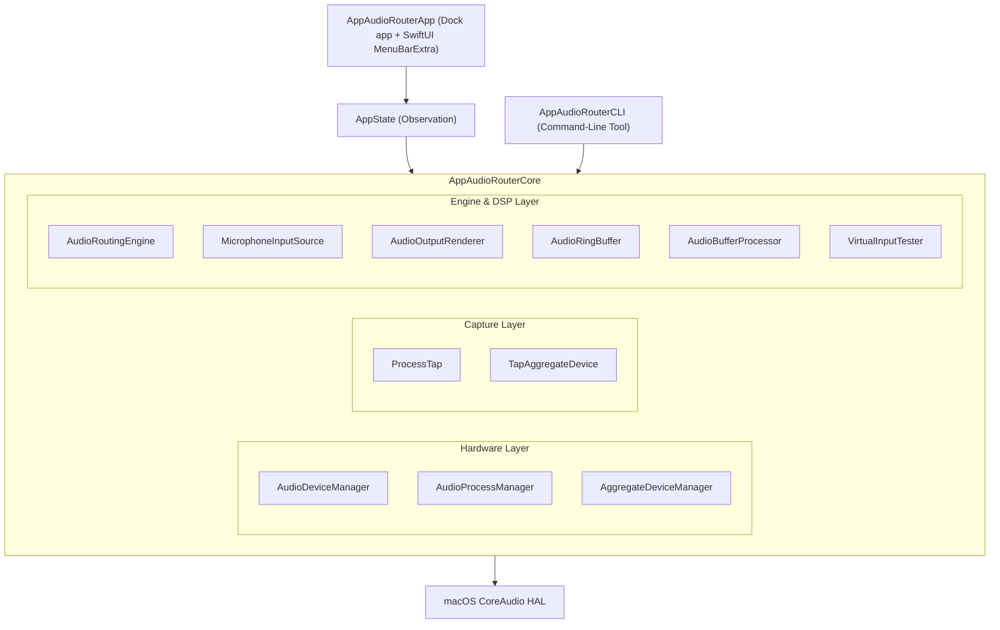
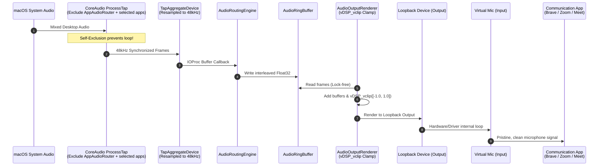
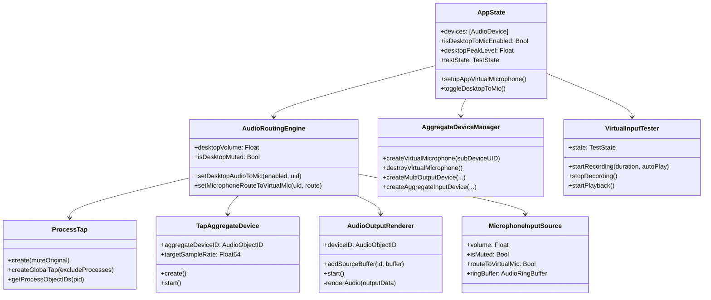

# AppAudioRouter アーキテクチャ設計書 (Architecture Design)

本ドキュメントは、`AppAudioRouter` のシステムアーキテクチャ、コンポーネント構成、データフロー、および設計上の重要判断について記述します。

---

## 1. システム全体構成

AppAudioRouter は、Swift Package Manager によるモジュール分割設計を採用しています。

---

## 2. モジュール構成と責務

### 2.1 レイヤ別責務一覧

| レイヤ / モジュール | 主要ファイル | 役割と責務 |
| :--- | :--- | :--- |
| **UI Layer** | `MenuBarContentView.swift` `LevelMeterView.swift` | メニューバーのポップオーバー描画、ユーザー操作（音量、ミュート、トグル、テスト録音）の受付、リアルタイム VU メーター表示。 |
| **State Layer** | `AppState.swift` | SwiftUI と CoreAudio エンジンを仲介する `@Observable` な状態保持クラス。デバイス変更の監視、エフェメラル仮想マイクの自動起動管理。 |
| **Hardware Management** | `AudioDeviceManager.swift` `AudioProcessManager.swift` `AggregateDeviceManager.swift` | CoreAudio HAL プロパティの問い合わせ・監視。Aggregate Device（マルチ出力・集約マイク・エフェメラル仮想マイク）の動的構築と破棄。 |
| **Tap Layer** | `ProcessTap.swift` `TapAggregateDevice.swift` | `CATapDescription` を用いたプロセス/グローバル音声キャプチャ。プライベート Aggregate Device によるリアルタイム IOProc バッファ取得。 |
| **Audio Engine & DSP** | `AudioRoutingEngine.swift` `AudioOutputRenderer.swift` `MicrophoneInputSource.swift` `AudioRingBuffer.swift` `AudioBufferProcessor.swift` | 複数ストリームのミキシング、スレッドセーフな循環バッファ管理、vDSP によるゲインスケーリング・クリッピング防止・VU 計測。 |
| **Testing Engine** | `VirtualInputTester.swift` | 仮想マイクの入力を直接キャプチャし、WAV ファイル作成およびスピーカーでのセルフ再生を行う独立テストシステム。 |
| **CLI Layer** | `main.swift` | デバッグ、デバイス診断、パイプライン検証、マイクテストを行うスタンドアロン CLI。 |

---

## 3. 音声データフローとフィードバック防止

### 3.1 デスクトップ音声から仮想マイクへのデータフロー

### 3.2 フィードバックループ防止の設計（Critical Design Decision）
- **課題**: `CATapDescription(stereoGlobalTapButExcludeProcesses:)` は、デフォルトの空配列 `[]` の場合、自アプリ（`AppAudioRouter`）が仮想マイクの出力ポートに書き込んだ音声も「システム再生音」として再キャプチャしてしまう。
- **メカニズム**:
  1. `ProcessTap.getProcessObjectIDs()` により、自プロセス（`getpid()`）に割り当てられた `AudioObjectID` を CoreAudio HAL から動的に検索。
  2. グローバルタップ作成時にこの ID を必ず除外リストに含める。
  3. これにより、仮想マイクへ出力した音声が再キャプチャされるループを物理的に遮断し、発散・歪みノイズを 100% 防止。
- **アプリ別除外**: `AppState` は Bundle ID の選択を UserDefaults に保存する。タップ開始時に `AudioProcessManager` の CoreAudio プロセス一覧から該当アプリと helper の `AudioObjectID` を集め、自己除外IDと一緒に `ProcessTap.createGlobalTap(excludeProcesses:)` へ渡す。選択変更時に稼働中のタップを再作成する。対象のプロセスIDが未生成の場合、除外は未解決として UI に示す。

### 3.3 サンプリングレート同期の設計
- **課題**: デフォルトのデスクトップタップは 44.1kHz で動作する場合がある一方、仮想マイク/ループバックドライバは通常 48.0kHz で動作する。非同期のままバッファに書き込むと、リーダーが速く消費してリングバッファがアンダーランし、音飛びやピッチの上昇（約8.8%）を招く。
- **解決策**:
  - `TapAggregateDevice` の生成直後に、HAL プロパティ `kAudioDevicePropertyNominalSampleRate` を出力先レート（48,000Hz）に明示的に設定。
  - CoreAudio の Aggregate サブシステムにネイティブな高品質リサンプリングを行わせることで、バッファの完全同期を実現。

### 3.4 永続的デバイスUIDとWebRTCサイレントフォールバック防止の設計
- **課題**: 仮想マイクの集約デバイス生成時にランダムなUUIDを使用すると、アプリ再起動やデバイス再作成のたびにCoreAudio上のUIDが変化する。BraveやChrome等のChromiumベースブラウザ（WebRTC）は、保存したデバイストークン（UIDハッシュ）が消失するとエラーを出さずにOSの「既定の入力デバイス（BluetoothやUSBマイク）」へサイレントフォールバック（自動再接続）してしまい、UIの表記と実際のキャプチャ先が乖離する障害を引き起こしていた。
- **解決策**:
  - `AggregateDeviceManager.virtualMicUID`（`com.appaudiorouter.virtualmic.default`）を導入し、決定論的な固定UIDで集約デバイスを生成。
  - 同じUIDと同じループバックサブデバイスを持つ既存 Aggregate Input Device は再利用する。それ以外の古い同名または同UIDデバイスを破棄して作り直す。
  - ChromiumのAUHAL層が集約デバイスの入力を拒否する環境向けに、基底ループバックドライバ（`BlackHole 2ch`）への直接接続パスを案内。

### 3.5 仮想マイクの識別と所有権
- UIと録音テスターは `AudioDevice.isAppVirtualMicrophone` を共有し、固定UID・Aggregate・入力属性を照合する。一般の集約マイクのUIDプレフィックスや表示名では識別しない。
- 再利用判定は `kAudioAggregateDevicePropertyFullSubDeviceList` の設定済みUIDで行う。ActiveSubDeviceListの一時的な欠落を構成変更として扱わない。
- 再利用した他プロセスのデバイスは `managedDeviceIDs` に追加せず、通常のクリーンアップでは破棄しない。他プロセスの異なる構成を自動的に再作成しない。
- `watch-input` はデバイス全体のスナップショットを比較する診断。ブラウザ内部の選択や変更元プロセスは観測できない。

### 3.6 Braveのサイト別マイク固定
- 任意の `BrowserExtension` は ChatGPT/Gemini origin の `document_start` に MAIN world content script を注入する。
- ページの `getUserMedia()` が音声を要求した場合に限り、許可済みデバイス一覧から BlackHole 2ch、次いでAppAudioRouter Virtual Microphoneを検索し、その origin用のIDを `deviceId: { exact: ... }` として渡す。
- 対象が列挙されない場合は `NotFoundError` で止める。物理入力やOS既定入力には切り替えない。Braveで開発者モードを使った読み込みが必要で、アプリ本体への組み込みは行わない。

---

## 4. クラス関係図 (Class Relationships)

---

## 5. 技術選定の理由

1. **Pure Swift & Swift Package Manager**:
   外部依存性（Cocoapods, Carthage 等）を排除し、OS 標準ツールチェーンのみでクリーンかつ高速にビルド可能。
2. **CoreAudio HAL & Process Tap (macOS 14.2+)**:
   従来の BlackHole 単体や kext を用いた方式と異なり、OS が公式に提供するセキュアなプロセスキャプチャ API を使用。SIP 無効化不要。
3. **Accelerate (vDSP)**:
   ゲイン調整（`vDSP_vsmul`）、バッファ加算（`vDSP_vadd`）、クリッピング（`vDSP_vclip`）、VU ピーク検出（`vDSP_maxmgv`）に SIMD 高速演算を活用し、CPU 負荷を極小化。
4. **リングバッファの競合処理**:
   `AudioRingBuffer` は IOProc から `os_unfair_lock_trylock` を使い、競合時は待たずに書き込みブロックを破棄するか、読み出し先を無音にする。制御操作の `clear()` は通常ロックを使うため、短い競合では音声ブロックが欠落する可能性がある。
5. **IOProc の作業量**:
   バッファと Atomic 状態はコールバック外で確保する。メーター通知は 50ms タイマーから UI へ渡し、デバイス・プロセス一覧の全件更新は 1.5 秒ごとに行わず CoreAudio/Workspace 通知で行う。

## Parallel Rust implementation

The migration uses four Cargo crates: `router-core` for platform-independent DSP/rings/atomic controls; `router-macos` for HAL ownership, process taps, IOProc routing and recording/playback; and `router-app`/`router-cli` as native frontends. Both frontends use the same backend. AppKit and route configuration stay on the main/control thread. Recording uses a cancellable worker and bounded callback buffers. HAL property listeners only mark an atomic dirty flag; Workspace launch/termination notifications mark a pending refresh, and the app refreshes snapshots outside listeners. Meter values are sampled at 50ms and visual updates pause while the popover is closed.

The real-time ring is protected by a single-attempt atomic gate, not a waiting spin loop. Renderer membership uses non-waiting `try_lock`. Callback memory is retained if HAL unregistration fails, preferring an explicit exceptional leak over a use-after-free. Global taps fail closed if self-exclusion cannot be resolved. Resource owners unregister IO before destroying tap aggregates and taps. The stable Swift pipeline remains available for comparison and is still the packaging default. See [Rust migration](rust-migration.md).

### Rust test preparation and feedback

The recording worker waits for the first received input block before publishing its atomic readiness flag. The main-thread test controller then starts the external system-sound player for an explicit desktop-route test. The worker accumulates recording peak and duration outside IOProc and returns a recording report. UI completion distinguishes an audible signal from silence before in-process playback, and exposes errors near the top of the panel. The external player is reaped/cancelled on test completion, reset, and shutdown. Audio callback allocation/wait constraints and self-exclusion remain unchanged.

### Browser track validation
The extension verifies native getUserMedia results before returning them and monitors device changes for locked streams. This does not change macOS default input or capture the physical game microphone.

### Extension toggle
The popup stores the enabled flag through the extension storage API. An isolated content script publishes settings to the MAIN-world microphone wrapper with an initial handshake. The wrapper gates acquisition until initialization and tracks a mode generation to reject stale results. Audio tracks acquired in either mode are stopped on transitions; video-only requests pass through.
