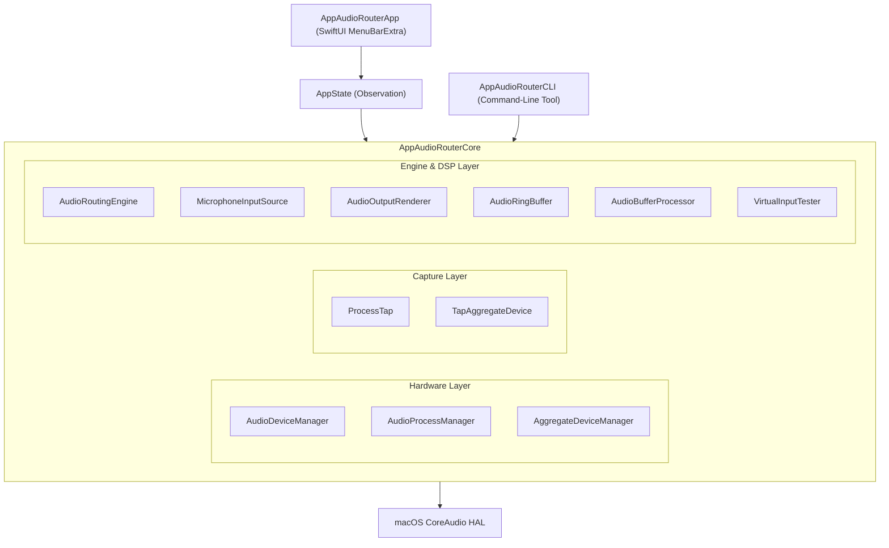
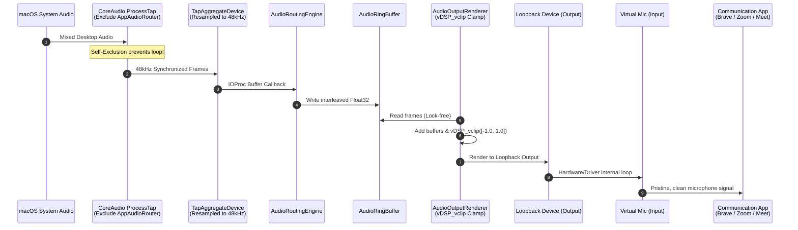

# AppAudioRouter アーキテクチャ設計書 (Architecture Design)

本ドキュメントは、`AppAudioRouter` のシステムアーキテクチャ、コンポーネント構成、データフロー、および設計上の重要判断について記述します。

---

## 1. システム全体構成

AppAudioRouter は、Swift Package Manager によるモジュール分割設計を採用しています。

---

## 2. モジュール構成と責務

### 2.1 レイヤ別責務一覧

| レイヤ / モジュール | 主要ファイル | 役割と責務 |
| :--- | :--- | :--- |
| **UI Layer** | `MenuBarContentView.swift` `LevelMeterView.swift` | メニューバーのポップオーバー描画、ユーザー操作（音量、ミュート、トグル、テスト録音）の受付、リアルタイム VU メーター表示。 |
| **State Layer** | `AppState.swift` | SwiftUI と CoreAudio エンジンを仲介する `@Observable` な状態保持クラス。デバイス変更の監視、エフェメラル仮想マイクの自動起動管理。 |
| **Hardware Management** | `AudioDeviceManager.swift` `AudioProcessManager.swift` `AggregateDeviceManager.swift` | CoreAudio HAL プロパティの問い合わせ・監視。Aggregate Device（マルチ出力・集約マイク・エフェメラル仮想マイク）の動的構築と破棄。 |
| **Tap Layer** | `ProcessTap.swift` `TapAggregateDevice.swift` | `CATapDescription` を用いたプロセス/グローバル音声キャプチャ。プライベート Aggregate Device によるリアルタイム IOProc バッファ取得。 |
| **Audio Engine & DSP** | `AudioRoutingEngine.swift` `AudioOutputRenderer.swift` `MicrophoneInputSource.swift` `AudioRingBuffer.swift` `AudioBufferProcessor.swift` | 複数ストリームのミキシング、スレッドセーフな循環バッファ管理、vDSP によるゲインスケーリング・クリッピング防止・VU 計測。 |
| **Testing Engine** | `VirtualInputTester.swift` | 仮想マイクの入力を直接キャプチャし、WAV ファイル作成およびスピーカーでのセルフ再生を行う独立テストシステム。 |
| **CLI Layer** | `main.swift` | デバッグ、デバイス診断、パイプライン検証、マイクテストを行うスタンドアロン CLI。 |

---

## 3. 音声データフローとフィードバック防止

### 3.1 デスクトップ音声から仮想マイクへのデータフロー

### 3.2 フィードバックループ防止の設計（Critical Design Decision）
- **課題**: `CATapDescription(stereoGlobalTapButExcludeProcesses:)` は、デフォルトの空配列 `[]` の場合、自アプリ（`AppAudioRouter`）が仮想マイクの出力ポートに書き込んだ音声も「システム再生音」として再キャプチャしてしまう。
- **メカニズム**:
  1. `ProcessTap.getProcessObjectIDs()` により、自プロセス（`getpid()`）に割り当てられた `AudioObjectID` を CoreAudio HAL から動的に検索。
  2. グローバルタップ作成時にこの ID を必ず除外リストに含める。
  3. これにより、仮想マイクへ出力した音声が再キャプチャされるループを物理的に遮断し、発散・歪みノイズを 100% 防止。

### 3.3 サンプリングレート同期の設計
- **課題**: デフォルトのデスクトップタップは 44.1kHz で動作する場合がある一方、仮想マイク/ループバックドライバは通常 48.0kHz で動作する。非同期のままバッファに書き込むと、リーダーが速く消費してリングバッファがアンダーランし、音飛びやピッチの上昇（約8.8%）を招く。
- **解決策**:
  - `TapAggregateDevice` の生成直後に、HAL プロパティ `kAudioDevicePropertyNominalSampleRate` を出力先レート（48,000Hz）に明示的に設定。
  - CoreAudio の Aggregate サブシステムにネイティブな高品質リサンプリングを行わせることで、バッファの完全同期を実現。

---

## 4. クラス関係図 (Class Relationships)

---

## 5. 技術選定の理由

1. **Pure Swift & Swift Package Manager**:
   外部依存性（Cocoapods, Carthage 等）を排除し、OS 標準ツールチェーンのみでクリーンかつ高速にビルド可能。
2. **CoreAudio HAL & Process Tap (macOS 14.2+)**:
   従来の BlackHole 単体や kext を用いた方式と異なり、OS が公式に提供するセキュアなプロセスキャプチャ API を使用。SIP 無効化不要。
3. **Accelerate (vDSP)**:
   ゲイン調整（`vDSP_vsmul`）、バッファ加算（`vDSP_vadd`）、クリッピング（`vDSP_vclip`）、VU ピーク検出（`vDSP_maxmgv`）に SIMD 高速演算を活用し、CPU 負荷を極小化。
4. **`os_unfair_lock` によるリングバッファ**:
   リアルタイムオーディオコンテキスト（IOProc）内では、Objective-C ランタイムのロックや `NSLock` によるブロッキングを避け、低オーバーヘッドな低水準スピンロックを採用。
